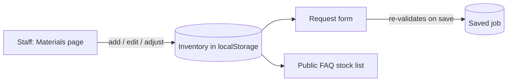

# School 3D Print Farm Demo — v1.1.1

**A responsive, frontend-only prototype for a school 3D-print request workflow.**


[Quick start](#quick-start) · [Routes](#routes) · [What's new](#v111-release-summary) · [Limits](#data-backend-and-security-limits) · [Testing](#testing) · [Files](#project-structure)

---

> [!WARNING]
>
> This is a **demonstration only**. Do not use it with real student data, production requests, or stock control that needs shared or secured records.

Version 1.1 simplifies the public homepage, adds browser-persistent filament inventory and student contribution records, and connects public material availability to the same inventory used by the request form. Version 1.1.1 adds interactive 3D model previews and direct HTTPS model URL support.

## Quick start

Requires **Python 3**. No build step or installation of dependencies is required.

```sh
python3 -m http.server 8000
```

Open [http://localhost:8000](http://localhost:8000). Stop the server with `Control-C`.

An internet connection is required to load the pinned Three.js and fflate preview modules from jsDelivr.

## Routes

| Route | Page |
| --- | --- |
| `#/` | Public landing page and FAQ |
| `#/get-started` | Four-step request wizard |
| `#/my-jobs` | Student demo job tracking |
| `#/staff` | Staff overview |
| `#/staff/queue` | Searchable and filterable job queue |
| `#/staff/active` | Jobs assigned to the demo staff member |
| `#/staff/materials` | Filament inventory management |
| `#/staff/hours` | Student contribution hours |
| `#/staff/jobs/:id` | Job details and status actions |
| `#/section/faq` | Public FAQ anchor |

## v1.1.1 release summary

The public home page removes the requested header FAQ link, tagline, promotional line, and brand eyebrow. The remaining hero content fills the page without the removed stats row.

The Get Started form accepts STL, 3MF, and OBJ files up to 25 MB. It previews the selected model geometry in an interactive Three.js viewport with orbit, zoom, and pan controls. The file is parsed in the browser and only filename and size metadata enter the local demo request; model bytes are not uploaded or saved. Replacing or removing a model disposes the prior preview.

Users can also provide a direct HTTPS model URL. The browser retrieves the file without credentials, enforces the same 25 MB limit, then passes the bytes through the same validation and preview flow. The source must allow cross-origin browser access (CORS); authenticated pages, indirect links, or servers that block CORS are reported as unavailable. There is no backend proxy. The 3MF loader uses fflate 0.8.3 for ZIP parsing.

Three.js 0.186.0 and fflate 0.8.3 are pinned CDN dependencies. The app is still static and has no build step or server-side storage.

### Public homepage

The homepage no longer includes the `01 / Capabilities`, `02 / Material Intelligence`, `03 / How It Works`, or `04 / Print Farm` sections. Their navigation and footer links, artwork, and section styles were removed.

It keeps the **hero**, **use cases**, **FAQ**, and **request call to action**. Job submission and tracking remain available.

The **Good questions** FAQ explains what filament is and compares the supported materials (**PLA**, **PETG**, **TPU**) by typical uses, behavior, and printing considerations. Its color and stock status list comes from the same inventory used by the request form.

> [!NOTE]
>
> Material descriptions live in `src/data.js`. Live stock comes from `src/services.js`.

### Staff Portal

Text, fields, navigation, tables, and buttons use larger, more consistent type, stronger contrast, and more comfortable spacing. The layout supports desktop, tablet, and smaller screens.

### Filament inventory

The **Materials** page can add and edit entries for PLA, PETG, and TPU, including:

- Color, quantity, unit, low-stock threshold, availability, and notes.
- Received-stock and consumption adjustments.
- Status flags for **low stock**, **out of stock**, and **unavailable** entries.

**Validation rules** (all enforced in the browser):

- Duplicate material/color entries are rejected.
- Negative quantities, unsupported units, and invalid updates are rejected.
- Adjustments cannot reduce stock below zero.

For a current quantity \(q\) and a consumption adjustment \(c\), an adjustment is accepted only if:

\[
q - c \ge 0
\]

A material/color combination is **selectable** in the request form only when:

\[
q > 0 \;\wedge\; \text{available} = \text{true}
\]

New installations start with an **empty inventory**, since the project contains no verified stock data. Staff must enter real stock before students can pick a material/color.

The request form loads current combinations when opened and **validates the selection again before saving a job**. The public FAQ reflects inventory additions and availability changes.

> [!TIP]
>
> Submitting a job does **not** deduct stock, and saved jobs keep their original material and color.



### My Hours

Teachers can add and edit student contribution records.

| Field | Rule |
| --- | --- |
| Date | Must be valid and not in the future |
| Duration | Positive, decimal hours allowed, at most 24 per record |
| Activity | Description of the contribution |

The page supports student search, date range filters, per-student totals, selected-period totals, and empty states. Totals are computed from saved records. For student \(s\) over a selected period \(P\), with record durations \(h_i\):

\[
T_{s,P} = \sum_{i \in R_{s,P}} h_i, \qquad 0 < h_i \le 24
\]

where \(R_{s,P}\) is the set of \(s\)'s records dated within \(P\).

> [!NOTE]
>
> There is no student directory. Records use entered display names and suggest names from existing demo records. They do not create or connect real student accounts.

### Browser verification performed for v1.1.1

- Checked the updated homepage navigation and request wizard in a narrow browser viewport. The desktop header FAQ link and requested promotional copy are removed; FAQ content remains available through the existing footer route.
- Loaded the official Three.js 3MF sample from a direct HTTPS URL, confirmed the geometry appeared in the preview, and dragged the viewport to orbit the model. An HTTP URL was rejected and the previous preview was cleared.
- Exercised the same parser and preview module with browser-created STL, OBJ, and 3MF `File` objects, including uppercase extensions. Confirmed replacement disposes the prior preview, and malformed models plus empty, unsupported, oversized, and non-HTTPS inputs are rejected.
- The native operating-system file chooser was not manually operated; local file parsing and rendering were covered through browser `File` objects.

The project has no package manifest, automated test suite, build, lint, or type-check scripts. Node.js was unavailable in the verification environment, so no JavaScript build or command-line checks were run. Verification used the static HTTP server and browser.

Direct-link loading depends on the host providing a downloadable file and permissive CORS headers; authenticated or private links cannot be fetched by this frontend-only demo. A production backend, real file storage, and printer workflow remain unavailable.

## Data, backend, and security limits

This repository is a **static frontend demo**. It contains no backend server, API routes, database configuration, models, or initialization procedure. `src/apiClient.js` is an inactive placeholder and makes no requests. There is no database layer or database migration procedure.

**Storage.** Jobs, notifications, inventory, and contribution records are saved in the browser's `localStorage` under:

```text
three-d-print-farm-demo-v3
```

- Existing job data is retained; older saved data is extended with empty `inventory` and `contributions` arrays on first read.
- Changes persist across reloads in the same browser and origin, but are **not** shared across browsers, devices, or users.
- Browser storage can be cleared by the user or unavailable due to browser settings. The app reports storage failures when it cannot persist changes.

**Security**

- Identity and role handling are mock-only.
- The Staff Portal has **no** server-side authentication or authorization; validation runs in the browser.
- `localStorage` is not a concurrency-safe database.

A production deployment needs a backend, a configured database, and real staff/student authorization. No schema SQL or migration files were added because there is no database layer. That is an architecture limitation, not a database connection failure.

## Testing

There is no automated test suite or package manifest. A standalone JavaScript syntax check could not be run because Node.js was not installed in the verification environment. The browser loaded and exercised the modules through the static server.

<details>
<summary><b>Manual verification performed for v1.1</b></summary>

- [x] Opened the homepage; confirmed the four removed sections and their navigation links are absent. Checked the filament FAQ's PLA, PETG, and TPU descriptions.
- [x] Added a test inventory entry in an isolated preview, recorded consumption, and confirmed the low-stock status and quantity in the Staff Portal and public FAQ.
- [x] Set that entry to unavailable in a second tab; the request form refreshed to an empty, disabled filament selection and blocked advancing with a stale selection.
- [x] Submitted a test job with an available PLA/color entry; the saved job kept its material and color, and inventory quantity was unchanged. An over-consumption adjustment was rejected and stock remained unchanged.
- [x] Added and edited a contribution record with decimal hours; checked student/date filtering and totals; the record persisted after reloading the isolated preview.
- [x] Inspected browser console output during these workflows; no errors or warnings.

**Not verifiable in this project:** a real backend workflow, authenticated staff access, cross-device persistence, and actual printer or file uploads.

</details>

## Existing demo behavior and limits

- Student and staff identities are fictional; authentication and role-based access are not implemented.
- The wizard accepts `.stl`, `.3mf`, and `.obj` files up to **25 MB**, parses their geometry for the preview, and keeps only filename and size as job metadata. It does not upload model contents.
- Notifications are simulated locally. No email is sent.
- Job status changes are simulated in the browser. The app does not connect to or control a 3D printer.
- The supported demo materials are PLA, PETG, and TPU. Colors and quantities are staff-entered local data and begin empty.

## Project structure

```text
.
├── index.html                  # App entry point
├── favicon.svg                 # App icon
└── src/
    ├── app.js                  # Hash routing, shared state, UI event handling
    ├── publicPages.js           # Public page templates
    ├── studentPages.js          # Student page templates
    ├── staffPages.js            # Staff page templates
    ├── requestWizard.js          # Request form, dynamic filament selection, review flow
    ├── pageShared.js             # Shared navigation and formatting
    ├── visualComponents.js       # Shared artwork
    ├── data.js                   # Demo identities, material descriptions, seed jobs, notifications
    ├── services.js               # Local jobs, inventory, contributions; validation, transitions, drafts
    ├── authService.js             # Mock identity interface
    ├── filesService.js            # Model filename, size, extension, and HTTPS URL validation
    ├── modelPreview.js            # Three.js model parsing, interactive preview, renderer cleanup
    ├── notificationsService.js    # Simulated notification state
    ├── apiClient.js               # Inactive API placeholder (no network requests)
    └── styles.css                # Styles and responsive behavior
```

---

<sub>For demonstration only. Do not use with real student data or production requests.</sub>
