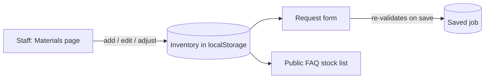

# School 3D Print Farm Demo - v1.3b

**A responsive, frontend-only prototype for a school 3D-print request workflow.**


---

Version 1.3 Beta adds a site-wide appearance system with six selectable accent colours and persistent light and dark themes. The controls are available across public, student, and staff pages.

## Quick start

Requires **Python 3**. No build step or installation of dependencies is required.

```sh
python3 -m http.server 8000
```

Open [http://localhost:8000](http://localhost:8000). Stop the server with `Control-C`.

An internet connection is required to load the pinned Three.js and fflate preview modules from jsDelivr.

## Routes

| Route | Page |
| --- | --- |
| `#/` | Public landing page and FAQ |
| `#/get-started` | Four-step request wizard |
| `#/my-jobs` | Student demo job tracking |
| `#/staff` | Staff overview |
| `#/staff/active` | Jobs assigned to the demo staff member |
| `#/staff/materials` | Current filament inventory |
| `#/staff/materials/new` | Add a filament entry |
| `#/staff/materials/:id` | Filament details, editing, and stock adjustments |
| `#/staff/hours` | Student contribution hours |
| `#/staff/jobs/:id` | Job details and status actions |
| `#/section/faq` | Public FAQ anchor |

Legacy links to `#/staff/queue` redirect to the Staff Overview.

## v1.3 beta release summary

The accent palette includes Green (the default), Blue, Purple, Teal, Orange, and Rose. Accent and theme preferences persist independently across reloads and navigation. Centralized theme tokens keep links, buttons, focus states, active navigation, forms, cards, and other shared components consistent; success, warning, error, and information colors retain their semantic meanings.

The light theme covers public, student, and staff interfaces while preserving the existing dark theme. The appearance controls support keyboard use and remain available in responsive layouts.

### Previous release details (v1.2b)

Version 1.2 Beta restored the Staff Overview with four job metrics and the six newest requests, removed the retired queue page from staff navigation, and streamlined the request wizard by removing layer-height and infill options. The Materials workspace supports adding, editing, and adjusting filament stock. The staff navigation includes Overview, My active jobs, Materials, and My Hours. Older `#/staff/queue` links redirect to the Staff Overview.

### Public homepage

It provides basic information about the Print Farm's abilities, along with Q&A sections. 

> [!NOTE]
>
> Material descriptions live in `src/data.js`. Live stock comes from `src/services.js`.

### Staff Portal

The Overview shows four job counts—unclaimed, in progress, printing, and completed today—followed by a table of the six most recently submitted requests. Selecting a row opens its job details. The **My active jobs** page lists work assigned to the demo staff profile.

### Filament inventory

The **Materials** page can add and edit entries for PLA, PETG, and TPU, including:

- Color, quantity, unit, low-stock threshold, availability, and notes.
- Received-stock and consumption adjustments.
- Status flags for **low stock**, **out of stock**, and **unavailable** entries.

New installations start with an **empty inventory**, since the project contains no verified stock data. Staff must enter real stock before students can pick a material/color.

The request form loads current combinations when opened and **validates the selection again before saving a job**. The public FAQ reflects inventory additions and availability changes.

> [!TIP]
>
> Submitting a job does **not** deduct stock, and saved jobs keep their original material and color.



### My Hours

Teachers can add and edit student contribution records.

| Field | Rule |
| --- | --- |
| Date | Must be valid and not in the future |
| Duration | Positive, decimal hours allowed, at most 24 per record |
| Activity | Description of the contribution |

> [!NOTE]
>
> There is no student directory. Records use entered display names and suggest names from existing demo records. They do not create or connect real student accounts.

## Data, backend, and security limits

This repository is a **static frontend demo**. It contains no backend server, API routes, database configuration, models, or initialization procedure. `src/apiClient.js` is an inactive placeholder and makes no requests. There is no database layer or database migration procedure.

**Storage.** Jobs, notifications, inventory, and contribution records are saved in the browser's `localStorage` under:

```text
three-d-print-farm-demo-v3
```

- Existing job data is retained; older saved data is extended with empty `inventory` and `contributions` arrays on first read.
- Changes persist across reloads in the same browser and origin, but are **not** shared across browsers, devices, or users.
- Browser storage can be cleared by the user or unavailable due to browser settings. The app reports storage failures when it cannot persist changes.

**Security**

- Identity and role handling are mock-only.
- The Staff Portal has **no** server-side authentication or authorization; validation runs in the browser.
- `localStorage` is not a concurrency-safe database.

A production deployment needs a backend, a configured database, and real staff/student authorization. No schema SQL or migration files were added because there is no database layer. That is an architecture limitation, not a database connection failure.

## Existing demo behavior and limits

- Student and staff identities are fictional; authentication and role-based access are not implemented.
- The wizard accepts `.stl`, `.3mf`, and `.obj` files up to **25 MB**, parses their geometry for the preview, and keeps only filename and size as job metadata. It does not upload model contents.
- Notifications are simulated locally. No email is sent.
- Job status changes are simulated in the browser. The app does not connect to or control a 3D printer.
- The supported demo materials are PLA, PETG, and TPU. Colors and quantities are staff-entered local data and begin empty.

## Project structure

```text
.
├── index.html                  # App entry point
├── favicon.svg                 # App icon
└── src/
    ├── app.js                  # Hash routing, shared state, UI event handling
    ├── publicPages.js           # Public page templates
    ├── studentPages.js          # Student page templates
    ├── staffPages.js            # Staff page templates
    ├── requestWizard.js          # Request form, dynamic filament selection, review flow
    ├── pageShared.js             # Shared navigation and formatting
    ├── visualComponents.js       # Shared artwork
    ├── data.js                   # Demo identities, material descriptions, seed jobs, notifications
    ├── services.js               # Local jobs, inventory, contributions; validation, transitions, drafts
    ├── authService.js             # Mock identity interface
    ├── filesService.js            # Model filename, size, extension, and HTTPS URL validation
    ├── modelPreview.js            # Three.js model parsing, interactive preview, renderer cleanup
    ├── notificationsService.js    # Simulated notification state
    ├── apiClient.js               # Inactive API placeholder (no network requests)
    └── styles.css                # Styles and responsive behavior
```
<sub>For demonstration only. Do not use with real student data or production requests.</sub>
---
